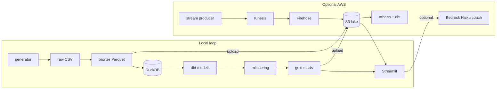

# FinanceBuddy

I built this to learn how a personal-finance **lakehouse** fits together end to end — not as a real bank product.

Fake users get fake transactions (with a few planted “gotchas” like double Netflix-y subscriptions and sketchy fraud bursts). Those land as files, get cleaned with **dbt**, scored with a bit of **ML**, and show up in a **Streamlit** UI. Same project can stay on your laptop (DuckDB) or talk to **S3 / Athena**. There’s also a small **Kinesis → Firehose** streaming demo and an optional **Bedrock** tab that explains the marts in plain English without inventing numbers.

If you’re reading this for a portfolio: treat it as a learning system. The data is synthetic on purpose so I could measure whether the pipeline recovers the planted signals.

## How the pieces connect



More detail: [docs/architecture.md](docs/architecture.md).

## What it actually does

- Builds ~250 users × ~18 months of transactions (configurable in `config/settings.yaml`)
- Plants ground truth (dup subscriptions, price creep, fraud-ish bursts, etc.) so eval isn’t vibes-only
- dbt staging → intermediate → marts (cashflow, subscriptions, duplicates, …)
- ML: recurring charges, habits vs your own history, Isolation Forest fraud + reason codes, ranked suggestions
- Streamlit: pick a user, poke around, optional AI Coach tab
- Optional: push lake to S3, run dbt on Athena, stream a few hundred events through Kinesis

## Quick start (laptop)

```bash
python -m venv .venv
# Windows:  .venv\Scripts\activate
# mac/linux: source .venv/bin/activate

pip install -r requirements-pipeline.txt
python scripts/run_pipeline.py
streamlit run app/streamlit_app.py
```

`requirements.txt` is the lean set Streamlit Cloud installs. Local full pipeline needs `requirements-pipeline.txt`.


Polars is used instead of Pandas — partly preference, partly because Pandas has been flaky under some Windows Application Control setups.

`run_pipeline.py` is the whole local story: generate → bronze → dbt → ML → gold.

## Layout

```text
financebuddy/
├── config/              # settings.yaml — knobs live here
├── data/                # lake + duckdb (gitignored; regenerated)
├── generator/           # synthetic ledgers + planted events
├── dbt_financebuddy/    # SQL transforms (DuckDB or Athena target)
├── ml/                  # subscriptions, habits, fraud, suggestions, coach
├── app/                 # Streamlit UI + S3/Athena backends
├── scripts/             # pipeline, S3 upload, streaming setup/teardown
└── docs/                # deeper notes if you want them
```

## AWS (when you want the cloud story)

Short version — full notes in [docs/aws_deploy.md](docs/aws_deploy.md) and [docs/live_demo.md](docs/live_demo.md):

1. Create a bucket, set `FINANCEBUDDY_S3_BUCKET`
2. `python scripts/upload_to_s3.py --layers raw bronze gold`
3. Register bronze in Athena/Glue, run `dbt build --target athena`
4. Point the UI at S3 gold (local):

```bash
set FINANCEBUDDY_BACKEND=s3
set FINANCEBUDDY_S3_BUCKET=your-bucket
set FINANCEBUDDY_APP_PASSWORD=some-demo-password
streamlit run app/streamlit_app.py
```

5. **Public demo:** deploy on [Streamlit Community Cloud](https://share.streamlit.io) — main file `app/streamlit_app.py`, secrets as in [docs/live_demo.md](docs/live_demo.md).

DuckDB stays around for local iteration. For the portfolio narrative I usually lead with S3/Athena and mention DuckDB as the free local stand-in.

### Streaming (optional)

Kinesis holds the live events; Firehose dumps them into S3. Tear it down when you’re done so you’re not paying for an idle shard.

```bash
python scripts/stream_setup.py
python scripts/stream_produce.py --count 200
# ~60s later, objects show up under financebuddy/raw/stream/
python scripts/stream_teardown.py --yes --delete-s3-data
```

Details: [docs/streaming.md](docs/streaming.md).

### Bedrock coach (optional)

The AI Coach tab only sees a **capped JSON pack** from the marts. It shouldn’t invent merchants or dollar amounts; the harness strips citations that aren’t in the context. Enable notes: [docs/coach.md](docs/coach.md).

```bash
set FINANCEBUDDY_COACH_ENABLED=1
set FINANCEBUDDY_BEDROCK_MODEL=anthropic.claude-haiku-4-5-20251001-v1:0
streamlit run app/streamlit_app.py
```

## Money / cost

Local path is free. On AWS, keep a small budget alert ($10–20). Prefer S3 reads for the live UI over firing Athena on every click. Delete Kinesis/Firehose after demos.

## Docs map

| Doc | What’s in it |
|-----|----------------|
| [docs/architecture.md](docs/architecture.md) | Diagrams + layer meanings |
| [docs/aws_deploy.md](docs/aws_deploy.md) | Glue/Athena/dbt on AWS |
| [docs/live_demo.md](docs/live_demo.md) | Hosting the Streamlit app on S3 gold |
| [docs/streaming.md](docs/streaming.md) | Kinesis → Firehose |
| [docs/coach.md](docs/coach.md) | Bedrock harness |
| [docs/learning_path.md](docs/learning_path.md) | Suggested order if you’re new to this stack |
