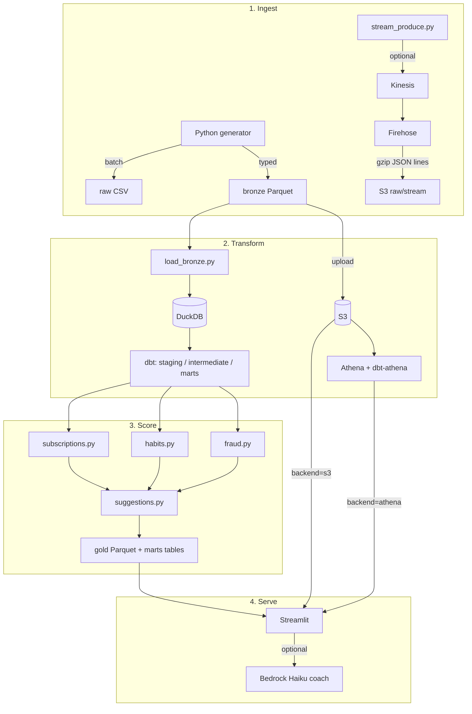

# Architecture

This is the mental model I use when navigating the repo. Nothing here is production banking infra — it’s a learning lakehouse with a UI on top.

## Big picture

## Why DuckDB and Athena both exist

DuckDB is the “warehouse on my laptop.” Same dbt project, different `--target`. Athena is the cloud twin once bronze/gold live on S3. Streamlit can read either DuckDB or S3 gold (S3 is what I’d use for a public demo so I’m not scanning Athena on every sidebar click).

## Medallion-ish layers

| Layer | What’s there | Notes |
|-------|----------------|-------|
| **raw** | CSV + ground_truth JSON/Parquet | Landing zone; ugly is fine |
| **bronze** | Typed Parquet (`users`, `transactions`, `merchants`) | What dbt sources read |
| **silver** | Mostly lives as dbt staging/intermediate in the warehouse | Folder exists; not a separate heavy Parquet pipeline |
| **gold** | Marts people actually query / the UI shows | Cashflow, subs, fraud scores, suggestions, … |

## Planted signals

The generator hides known cases so `ml/evaluate_ground_truth.py` can score recovery later:

- Overlapping music / cloud subscriptions  
- Subscription price creep  
- Same-merchant double charges  
- Micro-auth bursts + odd geo charges (fraud-ish)  
- Persona-driven spend spikes  

After a full pipeline run, check `ml/artifacts/ground_truth_recovery.json`.

## App backends

Controlled by `FINANCEBUDDY_BACKEND` (or `app.backend` in settings):

| Value | Reads from | When I use it |
|-------|------------|----------------|
| `duckdb` | local `data/financebuddy.duckdb` | day-to-day hacking |
| `s3` | `s3://…/financebuddy/gold/*.parquet` | portfolio / live demo |
| `athena` | Glue `marts` DB, falls back to S3 for ML-only tables | showing SQL-on-lake |

## Streaming vs batch

Batch is the main path (`run_pipeline.py`). Streaming is a side lesson: prove events can land in the lake without pretending the whole ML stack is real-time. Always run `stream_teardown.py` after playing — idle Kinesis shards are an easy way to waste money.
